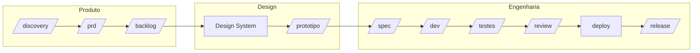
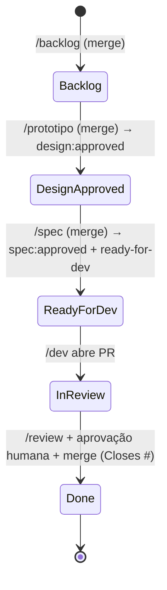

# Esteira — Documento de Design

> Esteira de produto e desenvolvimento conduzida por IA, do discovery ao deploy, construída como plugin do Claude Code e demonstrada numa série do YouTube.

| | |
|---|---|
| **Status** | Aprovado (sessão de design de 26/11/2026) |
| **Escopo** | Temporada 1 do canal + esteira v1 |
| **Idioma** | Vídeos e docs em PT-BR; código, arquivos e identificadores em inglês; slash commands em PT-BR |
| **Comandos** | Skills de plugin ficam sob o namespace do plugin: `/esteira:<etapa>` (ex.: `/esteira:discovery`, `/esteira:status`) |

---

## 1. Contexto e objetivo

Mostrar, em vídeo, que é possível levar um produto de **ideia bruta → produção** com IA conduzindo cada etapa, e humanos aprovando nos pontos de decisão — com um processo crível, auditável e reproduzível.

A esteira é o **entregável reutilizável** do canal: quem assiste instala o plugin e roda com a própria ideia. O produto construído é só o caso de uso.

### Objetivos

- Esteira completa cobrindo produto (discovery, PRD, backlog), design (DS, protótipo) e engenharia (spec, dev, testes, review, deploy, release).
- Gates humanos explícitos e visíveis.
- Rastreabilidade ponta a ponta: critério de aceite → teste → CI.
- Tudo público, gratuito para reproduzir (free tiers) e com custo de IA transparente.

### Não-objetivos

- Esteira de produção de conteúdo (roteiro, gravação, edição) — fora deste design.
- Observabilidade, analytics de produto e documentação de usuário final — fora da T1.
- Qualquer vínculo com a APIPASS: contas, repositórios e skills são pessoais e escritos do zero. Aprendizado pode ser reaproveitado; texto e estrutura das skills da empresa, não.

---

## 2. Visão geral



Cada etapa produz um **artefato versionado** que entra por **Pull Request**. O merge do PR é o gate humano; ao mergear, a esteira aplica a label correspondente e move o card no GitHub Projects.

`/esteira:status` mostra a qualquer momento o estado do produto: o que está em cada etapa e qual o próximo passo.

---

## 3. Etapas

| # | Comando | Entrada | Artefato | Gate (PR) | Efeito no merge |
|---|---|---|---|---|---|
| 1 | `/esteira:discovery` | Ideia bruta (1 parágrafo) | `docs/product/discovery.md` — problema, persona, concorrentes, proposta de valor, nome | PR de docs | — |
| 2 | `/esteira:prd` | discovery.md | `docs/product/prd.md` — visão, escopo do MVP, fora de escopo, métricas de sucesso | PR de docs | — |
| 3 | `/esteira:backlog` | prd.md | Issues de épicos e stories (user story + Gherkin com IDs) no GitHub Projects, priorizadas | PR com `docs/specs/<issue>-<slug>.md` (seção de produto) | Stories em `Backlog` |
| 4 | `/esteira:design-system` | discovery.md (marca) | `docs/design/`, tokens em CSS vars, tema shadcn light/dark, regra de lint | PR de código | — |
| 5 | `/esteira:prototipo` | Stories + DS | Telas navegáveis em shadcn com os tokens | PR com preview Vercel | label `design:approved` nas stories cobertas |
| 6 | `/esteira:spec` | Story + protótipo | Seção técnica em `docs/specs/<issue>-<slug>.md` — modelo de dados, contratos, decisões | PR de docs | labels `spec:approved` + `ready-for-dev` |
| 7 | `/esteira:dev` | Spec aprovada | Implementação em `feat/<issue>-<slug>` | PR com `Closes #<issue>` + preview | — |
| 8 | `/esteira:testes` | Gherkin da story | Vitest + `e2e/<issue>-<slug>.spec.ts` referenciando os IDs dos ACs | Mesmo PR do dev | — |
| 9 | `/esteira:review` | PR aberto | Review por IA (correção, DS, rastreabilidade) comentado no PR | Aprovação humana + merge | Issue fechada, card em `Done` |
| 10 | deploy | Merge na `main` | Produção na Vercel, migrations aplicadas | Automático pós-merge | — |
| 11 | `/esteira:release` | Commits convencionais | Release PR do release-please, `CHANGELOG.md`, tag de versão | Merge do release PR | Versão publicada |

**Ordem de gravação** = ordem da tabela (protótipo **antes** da spec técnica: valida-se a experiência antes de desenhar a implementação).

---

## 4. Agentes

Cada comando é uma skill com template de artefato próprio, delegando a subagentes por papel:

| Subagente | Atua em |
|---|---|
| **PM** | discovery, prd, backlog |
| **Designer** | design system, protótipo |
| **Dev** | spec, dev |
| **QA** | testes, verificação de rastreabilidade |
| **Reviewer** | review (correção, aderência ao DS, cobertura de ACs) |

---

## 5. Gates, labels e estados

O PR é sempre o gate; labels são **consequência** do merge, não input manual.



- **T1:** tudo roda local; os comandos **leem** o estado das labels para saber o que fazer a seguir.
- **Ep12 ("piloto automático"):** dev, testes e review migram para GitHub Actions com a Claude Code Action, disparados pela label `ready-for-dev`.

---

## 6. Rastreabilidade (spec → teste → CI)

- Cada critério de aceite é escrito em **Gherkin PT-BR** (Dado / Quando / Então) com ID único: `AC-<issue>.<n>` (ex.: `AC-12.1`).
- Cada teste Playwright referencia o(s) ID(s) que cobre (ex.: no título: `test('AC-12.1 inicia o timer', …)`).
- Um **check de rastreabilidade** no CI lê `docs/specs/<issue>-<slug>.md` e `e2e/`, e **falha** se algum AC da story do PR não tiver teste correspondente.

---

## 7. Produto de demonstração

**Time tracker** na categoria do Clockify — inspirado na categoria, **com nome, marca e visual próprios** (nada de clonar telas ou identidade). O nome é decidido na câmera, no Ep1.

### MVP (T1) — single-user

- Login
- Clientes e projetos
- Timer start/stop
- Lançamento manual de horas
- Timesheet semanal
- Relatório simples de horas por projeto e período

### T2+ (episódios de feature)

Workspaces e times, convites, valor-hora/faturável, export CSV/PDF, tags, aprovações, integrações. A audiência pode votar a próxima feature.

### Stack

| Camada | Escolha |
|---|---|
| App | Next.js (App Router) + TypeScript |
| Banco | Postgres no **Neon** |
| ORM | Drizzle |
| Auth | Better Auth |
| UI | shadcn/ui + tokens próprios (light/dark) |
| Unit | Vitest |
| E2E | Playwright (contra o preview) |
| Deploy | **Vercel** — preview por PR, produção no merge na `main` |
| DB por PR | Branch do Neon por PR, migrations automáticas |
| Release | release-please |

---

## 8. Repositórios e convenções

Dois repositórios públicos, licença **MIT**:

### `esteira` (este repo)

Plugin + marketplace do Claude Code. Instalação:

```
/plugin install esteira --marketplace alexandredavi/esteira
```

```
esteira/
├── .claude-plugin/          # plugin.json + marketplace.json (source "./")
├── skills/<etapa>/SKILL.md  # uma skill por etapa → /esteira:<etapa> (status, discovery, prd, ...)
├── agents/                  # subagentes por papel (pm, designer, dev, qa, reviewer)
├── hooks/
├── scripts/                 # lógica determinística em Node (sem deps) + testes node --test
├── templates/               # templates de artefato, PR, issue e labels
├── evals/                   # evals das skills (claude plugin eval)
└── docs/
    ├── design.md            # este documento
    └── building-log.md      # diário de construção (base do making-of)
```

### `<produto>`

```
docs/product/discovery.md
docs/product/prd.md
docs/specs/<issue>-<slug>.md      ← story + Gherkin (IDs) + spec técnica
docs/design/                      ← DS: tokens, decisões
e2e/<issue>-<slug>.spec.ts        ← testes ligados aos ACs por ID
CHANGELOG.md                      ← release-please
```

### Git

- Branch por story: `feat/<issue>-<slug>` (ex.: `feat/12-timer-start-stop`)
- PR com `Closes #<issue>`
- **Squash merge** + **Conventional Commits** (alimentam o release-please)

---

## 9. CI (GitHub Actions) — repo do produto

Em todo PR:

1. Lint (inclui regra de DS — §10)
2. Typecheck
3. Vitest
4. Playwright contra o preview da Vercel
5. Check de rastreabilidade (§6)

Review por IA: local na T1 (`/esteira:review`); vira Action no Ep12.

No repo `esteira`: evals das skills no CI (§12).

---

## 10. Garantia de uso do Design System

- Tokens como CSS vars no tema do shadcn (light/dark), no repo do produto.
- **Lint** barra cores e espaçamentos crus (hex, rgb, valores arbitrários fora da escala).
- **Checklist no `/esteira:review`:** usou componente do DS? criou componente novo sem necessidade? respeitou tokens?

Sem enforcement, a IA inventa estilos e o DS vira decoração.

---

## 11. Execução, paralelismo e custos

| | T1 | Ep12+ |
|---|---|---|
| Onde roda | Local, Claude Code, disparado por você | GitHub Actions + Claude Code Action |
| Paralelismo | Uma story por vez | Várias stories em worktrees / agentes simultâneos |
| Custo | Assinatura pessoal do Claude | API key pessoal com limite de gasto |

Todas as contas (GitHub, Vercel, Neon, Anthropic) são **pessoais**. O custo real de IA de cada episódio é mostrado no vídeo.

---

## 12. Qualidade da própria esteira

- **Evals** com `claude plugin eval` para cada skill — prioridade às que geram artefatos consumidos por outras etapas (backlog, spec, testes).
  - Ex.: dado um PRD de exemplo, o backlog gerado precisa ter épicos, stories com user story, ACs em Gherkin com IDs válidos e únicos.
- Evals rodam no CI do repo `esteira`: mudar uma skill não pode quebrar as outras silenciosamente.
- **Diário de construção** (`docs/building-log.md`): decisões, falhas, retrabalhos — matéria-prima do episódio bônus.

---

## 13. Plano de construção (fora das câmeras)

A esteira é construída **inteira antes de gravar**, porque as etapas dependem umas das outras (formato da spec → geração de testes; labels do backlog → automação do Ep12).

| Fase | Entrega |
|---|---|
| F0 | Esqueleto do plugin + marketplace, `/esteira:status`, harness de evals, building-log |
| F1 | Etapas de produto: `/esteira:discovery`, `/esteira:prd`, `/esteira:backlog` (+ integração GitHub Issues/Projects) |
| F2 | Design System (template de tokens, tema, regra de lint) + `/esteira:prototipo` |
| F3 | `/esteira:spec`, `/esteira:dev`, `/esteira:testes` + check de rastreabilidade |
| F4 | `/esteira:review`, deploy (Vercel + Neon por PR), `/esteira:release` (release-please) |
| F5 | Piloto automático: workflows de Actions disparados por label |
| F6 | **Dry-run** ponta a ponta num produto descartável (to-do), corrigindo inconsistências entre etapas |
| → | Gravação da T1 no time tracker, do zero |

O time tracker fica "virgem" para a câmera; o dry-run usa outro produto.

---

## 14. Temporada 1

Formato de cada episódio: **uso da etapa + 2–4 min de anatomia** da skill (prompt, template, subagentes, decisões de design).

| Ep | Conteúdo |
|---|---|
| 0 | Apresentação da esteira + setup (repos, plugin, Vercel + Neon, CI base, `/esteira:status`) |
| 1 | `/esteira:discovery` — ideia → problema, persona, concorrentes, **nome do produto** |
| 2 | `/esteira:prd` — visão e escopo do MVP |
| 3 | `/esteira:backlog` — épicos, stories com Gherkin, priorização, GitHub Projects |
| 4 | Design System — identidade, tokens, tema, regra de lint |
| 5 | `/esteira:prototipo` — telas navegáveis, PR com preview |
| 6 | `/esteira:spec` — design técnico, modelo de dados, contratos |
| 7 | `/esteira:dev` — implementação da story, branch + PR |
| 8 | `/esteira:testes` — Gherkin → Playwright + rastreabilidade no CI |
| 9 | `/esteira:review` — review por IA + gate humano |
| 10 | Deploy — preview → produção, migrations, rollback |
| 11 | `/esteira:release` — release-please, changelog, versão |
| 12 | Piloto automático — dev, testes e review via Actions |
| Bônus | Making-of — como a esteira foi construída e o que deu errado |

**Fio narrativo:** do Ep5 ao Ep11, **uma única story** ("iniciar e parar o timer") atravessa todas as etapas na câmera. As demais stories do MVP passam pela esteira fora das câmeras (timelapse ou recap no início do episódio seguinte). O Ep12 mostra várias rodando sozinhas.

**T2+:** cada episódio entrega uma feature nova pela esteira inteira; episódios bônus comparando ferramentas alternativas em uma etapa (ex.: v0/Lovable no protótipo); episódio de paralelismo; possível ponte com Figma via Code Connect.

---

## 15. Registro de decisões

| ID | Decisão |
|---|---|
| Q1 | Público: conteúdo para YouTube pessoal |
| Q2 | Formato: gravado/editado |
| Q3 | Gates humanos em spec, protótipo e merge |
| Q4 | Esteira nova e independente (sem ferramentas/contas da APIPASS) |
| Q5 | Sem prazo; construção incremental |
| Q6 | T1 = um episódio por etapa; T2+ = uma feature por episódio |
| Q7 | Produto: SaaS simples, time tracker (referência: categoria do Clockify) |
| Q8 | GitHub Issues + Projects para fluxo; specs em markdown no repo |
| Q9 | DS = shadcn/ui + tokens próprios; protótipo direto em código |
| Q10 | Claude Code como espinha; comparações em episódios bônus |
| Q11 | Skills escritas do zero, repo público pessoal |
| Q12 | PT-BR; repo template + plugin como entregável |
| Q13 | MVP single-user (login, clientes/projetos, timer, manual, timesheet, relatório) |
| Q14 | Next.js + TS + Neon + Drizzle + Better Auth + shadcn |
| Q15 | Dois repos: `esteira` e `<produto>` |
| Q16 | 10 etapas + episódio de Design System |
| Q17 | Gate = PR; merge aplica label e move card |
| Q18 | ACs em Gherkin PT-BR → testes Playwright com rastreabilidade |
| Q19 | Vercel (preview por PR) + Neon (branch por PR) + domínio próprio |
| Q20 | T1 local; Ep12 migra para Actions |
| Q21 | Slash command por etapa (PT-BR) + `/esteira:status`; subagentes por papel |
| Q22 | Branch por issue, squash, Conventional Commits, release-please |
| Q23 | CI: lint, typecheck, Vitest, Playwright no preview, rastreabilidade |
| Q24 | Enforcement do DS via lint + checklist no review |
| Q25 | Uma story por vez na T1; paralelismo depois |
| Q26 | Contas pessoais; assinatura local, API key com limite nas Actions; custo no vídeo |
| Q27 | Produção de vídeo fora do escopo |
| Q28 | Esteira construída **fora das câmeras** |
| Q29 | Ordem da T1 com protótipo antes da spec; infra de preview no Ep0 |
| Q30 | Uma story como fio narrativo Ep5–Ep11 |
| Q31 | Distribuição via marketplace de plugin; MIT nos dois repos |
| Q32 | Convenção de artefatos e IDs `AC-<issue>.<n>` |
| Q33 | Esteira completa + dry-run em produto descartável antes de gravar |
| Q34 | Episódio = uso + 2–4 min de anatomia |
| Q35 | Episódio bônus de making-of, com building-log |
| Q36 | Evals das skills no CI do repo `esteira` |

---

## 16. Pontos a detalhar na construção

Não decididos na sessão de design; resolver durante F0–F6 e registrar no building-log:

- Granularidade do protótipo: por épico (cobrindo várias stories) ou por story.
- Onde o `/esteira:discovery` busca concorrentes (web search vs. input manual) e como cita fontes.
- Formato exato do check de rastreabilidade (script Node no CI vs. ação reutilizável publicada no repo `esteira`).
- Estratégia de rollback no deploy (Vercel instant rollback + migrations reversíveis).
- Seeds de dados para previews e para os testes E2E.
